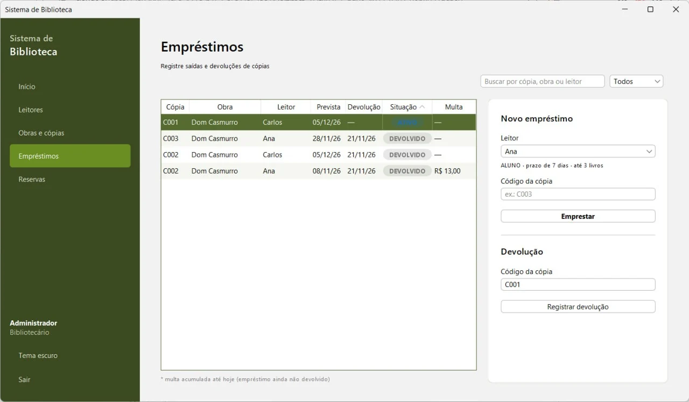
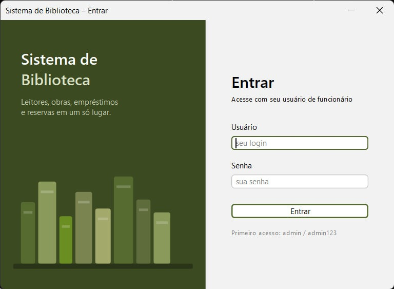
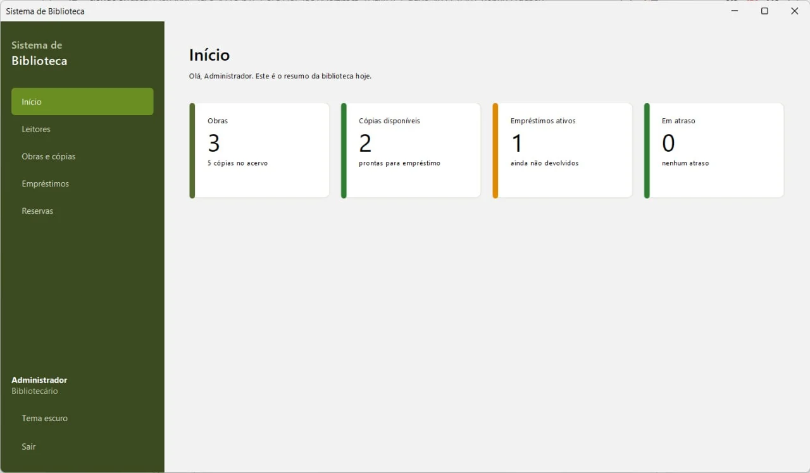
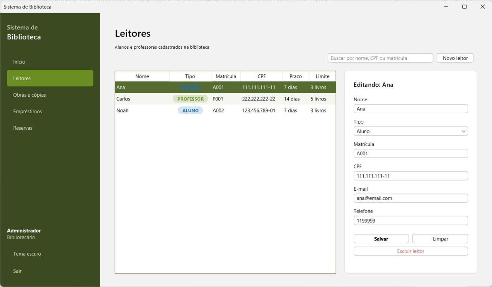
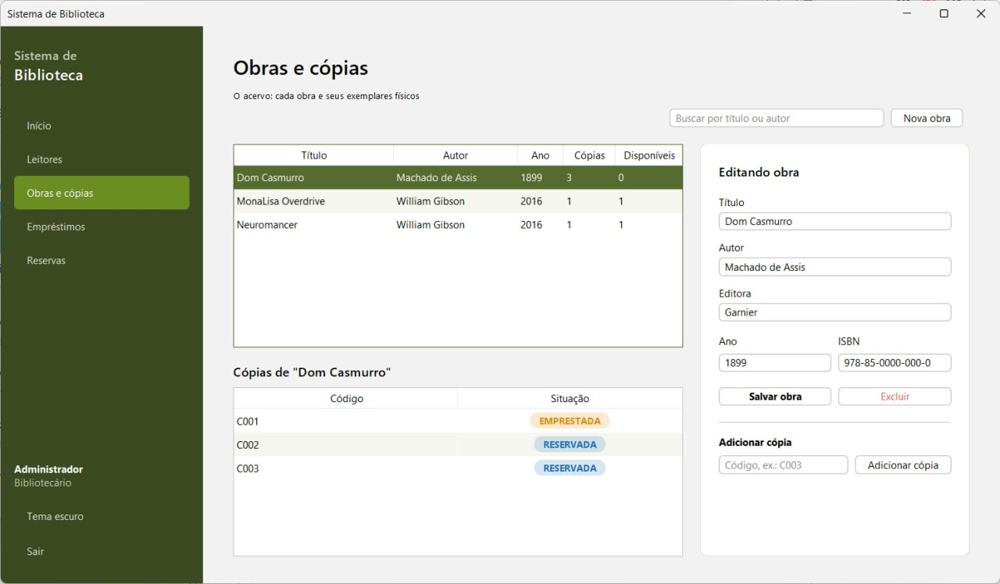
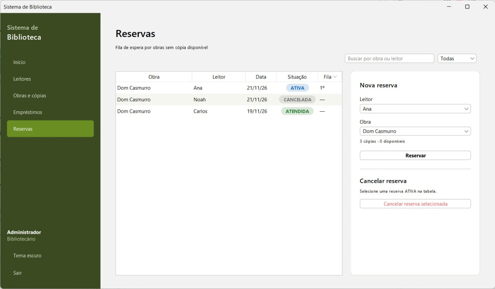
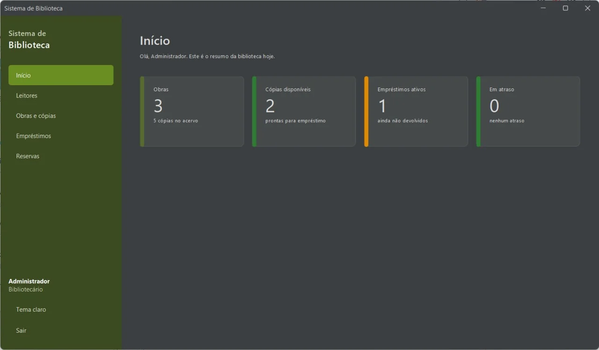
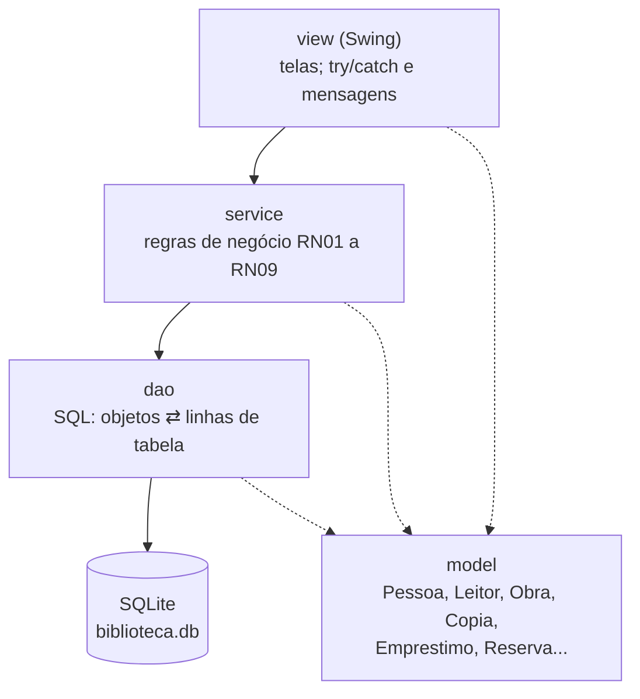

# Sistema de Biblioteca

Sistema desktop de controle de biblioteca desenvolvido em **Java 25**, com interface **Swing**, persistência em **SQLite** por uma camada **DAO** e foco na aplicação de **Programação Orientada a Objetos**: herança, polimorfismo, associação, agregação e encapsulamento.

Projeto da disciplina de Programação Orientada a Objetos. Controla leitores, funcionários, obras, cópias, empréstimos e reservas, com regras de negócio como limite de empréstimos por tipo de leitor, multa por atraso e fila de reservas.



## Funcionalidades

- **Login de funcionários** com senha protegida por hash PBKDF2 e salt
- **Painel inicial** com indicadores: obras, cópias disponíveis, empréstimos ativos e atrasados
- **Leitores**: cadastro de alunos e professores, com busca e validação de CPF e matrícula duplicados
- **Obras e cópias**: cadastro do acervo, com as cópias físicas de cada obra e sua situação
- **Empréstimos e devoluções**: prazo e limite conforme o tipo de leitor, bloqueio por atraso e cálculo automático de multa
- **Reservas**: fila de espera por obra, com a cópia devolvida guardada para o primeiro da fila
- **Tema claro e escuro**, alternável a qualquer momento

## Telas

| Login | Início |
| --- | --- |
|  |  |

| Leitores | Obras e cópias |
| --- | --- |
|  |  |

| Reservas | Tema escuro |
| --- | --- |
|  |  |

## Tecnologias

| Item | Uso |
| --- | --- |
| Java 25 (LTS) | Linguagem |
| Maven | Build e dependências |
| SQLite + `sqlite-jdbc` | Banco de dados em arquivo, via JDBC |
| Swing + FlatLaf | Interface gráfica com visual moderno |
| Git + GitHub | Versionamento |

## Arquitetura

O sistema é dividido em camadas. Cada uma conversa apenas com a camada logo abaixo, e as exceções sobem até a tela, onde são tratadas e exibidas ao usuário.



| Pacote | Responsabilidade |
| --- | --- |
| `model` | Classes do domínio e seu comportamento próprio |
| `dao` | Acesso ao banco com `PreparedStatement` (sem SQL fora desta camada) |
| `service` | Regras de negócio; lança `NegocioException` com mensagens para o usuário |
| `view` | Telas Swing; captura as exceções e mostra os avisos |
| `exception` | Exceção personalizada do sistema |
| `util` | Hash de senhas |

## Conceitos de Orientação a Objetos

| Conceito | Onde aparece |
| --- | --- |
| **Herança** | `Pessoa` → `Leitor` e `Funcionario`; `Leitor` → `Aluno` e `Professor` |
| **Classe abstrata** | `Pessoa`, `Leitor`, `PainelTela`, `ModeloTabela<T>` |
| **Polimorfismo** | `getPrazoDias()` e `getLimiteEmprestimos()`: 7 dias e 3 livros para Aluno, 14 dias e 5 livros para Professor, sem nenhum `if` sobre o tipo |
| **Agregação** | `Obra` agrega suas `Copia`s; a lista só é alterada por `adicionarCopia()` |
| **Associação** | `Emprestimo` → `Leitor`, `Copia` e `Funcionario`; `Reserva` → `Leitor` e `Obra` |
| **Encapsulamento** | Atributos `private`; lista de cópias exposta como somente leitura; estado de empréstimos e reservas alterado apenas por métodos com significado |
| **Sobrecarga e sobrescrita** | Dois construtores por entidade; `toString()`, `paintComponent()`, renderers de tabela |
| **Generics e Template Method** | `ModeloTabela<T>`: a classe-mãe cuida da tabela, cada subclasse define só o conteúdo das colunas |

Exemplo do polimorfismo no cálculo do prazo:

```java
// Emprestimo: o prazo vem do próprio leitor, seja ele Aluno ou Professor
this.dataPrevista = dataEmprestimo.plusDays(leitor.getPrazoDias());
```

## Regras de negócio

| Código | Regra |
| --- | --- |
| RN01 | Aluno: até 3 empréstimos ativos, prazo de 7 dias |
| RN02 | Professor: até 5 empréstimos ativos, prazo de 14 dias |
| RN03 | Só pode ser emprestada uma cópia DISPONÍVEL |
| RN04 | Leitor com empréstimo em atraso não pode fazer novo empréstimo |
| RN05 | Só é possível reservar uma obra sem cópia disponível |
| RN06 | Cópia devolvida de obra com reserva fica RESERVADA para o primeiro da fila |
| RN07 | Multa de R$ 1,00 por dia de atraso |
| RN08 | Acesso apenas para funcionários autenticados |
| RN09 | O empréstimo é registrado em nome do funcionário logado |

## Tratamento de exceções

As exceções são **lançadas** onde o problema é detectado e **tratadas na camada de interface**:

- `NegocioException` (checked): regra violada, exibida como aviso. Por ser checked, o compilador obriga cada tela a tratá-la.
- `SQLException`: falha técnica do banco, exibida como erro.
- `NumberFormatException`: dado digitado inválido (por exemplo, ano não numérico).

```java
try {
    emprestimoService.realizarEmprestimo(leitor, copia, funcionarioLogado, LocalDate.now());
} catch (NegocioException e) {
    JOptionPane.showMessageDialog(this, e.getMessage(), "Empréstimo não permitido", JOptionPane.WARNING_MESSAGE);
} catch (SQLException e) {
    JOptionPane.showMessageDialog(this, "Erro ao acessar o banco de dados", "Erro", JOptionPane.ERROR_MESSAGE);
}
```

## Como executar

**Pré-requisitos:** JDK 25 e Maven instalados.

```bash
git clone https://github.com/tvrsdigital/biblioteca-java.git
cd biblioteca-java
mvn compile exec:java
```

Na primeira execução, o banco `biblioteca.db` e as tabelas são criados automaticamente, junto com o usuário inicial:

| Login | Senha |
| --- | --- |
| `admin` | `admin123` |

### Demonstração das regras pelo console

A classe `DemonstracaoRegras` recria o banco com dados de exemplo (incluindo um empréstimo atrasado e uma reserva) e executa 13 cenários que exercitam as regras de negócio:

```bash
mvn compile exec:java "-Dexec.mainClass=br.com.biblioteca.DemonstracaoRegras"
```

> Atenção: a demonstração **apaga o banco atual** antes de rodar.

## Estrutura do projeto

```
src/main/java/br/com/biblioteca/
├── App.java                  # ponto de entrada: prepara o banco e abre o login
├── DemonstracaoRegras.java   # cenários de teste das regras, pelo console
├── model/                    # Pessoa, Leitor, Aluno, Professor, Funcionario, Obra, Copia, ...
├── dao/                      # ConexaoFactory, InicializadorBanco e um DAO por entidade
├── service/                  # regras de negócio
├── view/                     # telas Swing, tema e componentes desenhados
├── exception/                # NegocioException
└── util/                     # SenhaUtil (hash PBKDF2)
docs/
├── requisitos.md             # entidades e regras de negócio
├── diagrama-classes.md       # diagrama de classes (Mermaid)
├── decisoes.md               # registro de decisões de projeto (ADR)
└── tutorial.md               # passo a passo do desenvolvimento e teoria de POO
```

## Documentação

- [Requisitos e regras de negócio](docs/requisitos.md)
- [Diagrama de classes](docs/diagrama-classes.md)
- [Registro de decisões](docs/decisoes.md): o porquê de cada escolha, no formato de ADR
- [Tutorial de desenvolvimento](docs/tutorial.md): o projeto passo a passo, com a teoria de POO aplicada

## Limitações conhecidas

- Operações com várias gravações (empréstimo + situação da cópia) não usam transação; o risco está documentado na decisão D19.
- A interface Swing teve o layout gerado com auxílio de IA, conforme autorizado na disciplina (decisão D08). O tratamento de eventos e exceções foi revisado pelo autor.
