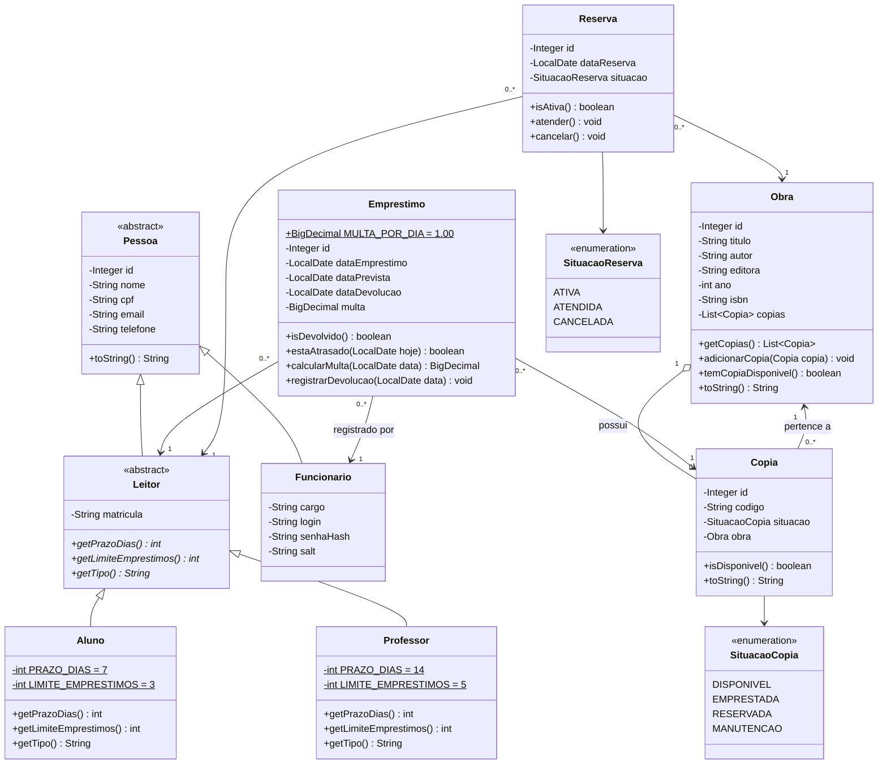

# Diagrama de Classes

## Legenda

| Símbolo | Conceito | Onde aparece |
|---|---|---|
| `<\|--` | Herança | Pessoa → Leitor/Funcionario; Leitor → Aluno/Professor |
| método com `*` | Método abstrato (base do polimorfismo) | `getPrazoDias()`, `getLimiteEmprestimos()`, `getTipo()` em Leitor |
| `o--` | Agregação | Obra ◇— Copia |
| `-->` | Associação | Emprestimo e Reserva com Leitor, Copia, Obra e Funcionario; Copia → Obra |
| `$` | Membro estático (constante) | `PRAZO_DIAS`, `LIMITE_EMPRESTIMOS` |

## Observações

- `Pessoa` e `Leitor` são abstratas: só Aluno, Professor e Funcionario são instanciados.
- O `id` é `Integer` para que `null` represente um objeto ainda não salvo no banco.
- `getTipo()` permite gravar Aluno e Professor na mesma tabela, com uma coluna `tipo`, sem uso de `instanceof`.
- A relação Obra–Copia é bidirecional: a Obra mantém a lista de cópias e cada Copia conhece sua Obra. A lista só é alterada por `adicionarCopia()`, que mantém os dois lados consistentes.
- `Funcionario` guarda apenas o hash e o salt da senha, nunca a senha em texto puro.
- `Emprestimo` calcula a data prevista com `leitor.getPrazoDias()` (polimorfismo) e recebe as datas como parâmetro nos métodos, o que permite testar atrasos sem depender do relógio.
- `Emprestimo` e `Reserva` quase não têm setters: seu estado muda apenas por métodos com significado (`registrarDevolucao`, `atender`, `cancelar`). `Reserva` lança `IllegalStateException` se a operação não for permitida na situação atual.